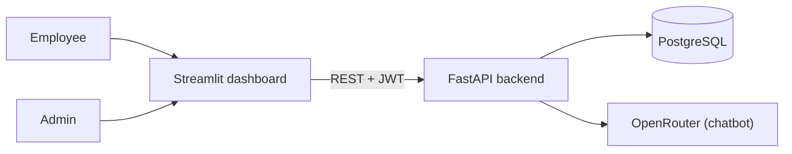

# Attendance Management Platform

An AI-powered attendance management system. A FastAPI backend (on Supabase
PostgreSQL) handles authentication, attendance, shift/employee administration,
reporting and an AI chatbot. A Streamlit dashboard provides the UI for
employees and admins.

## Main features

- **Authentication & RBAC** — JWT login/logout with two roles, `employee` and
  `admin`. Registration always creates an employee; admins are created out of
  band.
- **Attendance** — punch in / punch out, today's record, own history. Late,
  half-day, early-leave and overtime are computed by a rules engine (grace
  periods, per-shift timezones, overnight shifts).
- **Admin directory** — manage departments, shifts and employee-shift
  assignments, with overlapping assignments blocked at the database level.
- **Reports & analytics** — daily summaries, trends, late arrivals, absences
  and absenteeism, computed deterministically in Python/SQL (never by the AI).
- **AI chatbot** — answers attendance questions using six read-only tools. The
  model only phrases answers; it never computes numbers or writes SQL itself.
- **Audit trail** — every admin action and report/chat query is logged.
  Logging is append-only, enforced by a database trigger.
- **Demo-data seeder** — fills an empty database with a realistic
  organisation for demos.

Not implemented: **leave requests have no API endpoint** yet (see
[Known limitations](#known-limitations)).

## Technology stack

| Layer      | Choice                                         |
| ---------- | ---------------------------------------------- |
| API        | FastAPI + Uvicorn                               |
| Database   | Supabase PostgreSQL via SQLAlchemy 2 (async)    |
| Migrations | Alembic                                         |
| Dashboard  | Streamlit                                       |
| Tests      | pytest + pytest-asyncio                         |
| Packaging  | Docker + Docker Compose                         |
| AI         | OpenRouter (`stepfun/step-3.7-flash`) via the `openai` SDK |

## Architecture overview



The dashboard only talks to the API over HTTP — it holds no database
credentials. More diagrams (components, data model, sequence flows) are in
[`docs/diagrams/`](docs/diagrams/).

## Local setup

**1. Create a virtual environment and install dependencies**

```bash
python -m venv .venv
.venv\Scripts\Activate.ps1      # Windows
source .venv/bin/activate       # macOS / Linux

pip install -r requirements-dev.txt   # runtime + test/lint tooling
```

**2. Configure environment variables**

```bash
cp .env.example .env    # Windows: copy .env.example .env
```

Key variables (full list and defaults are documented in `.env.example` and
`app/core/config.py`):

| Variable | Required | Notes |
| --- | --- | --- |
| `DATABASE_URL` | yes | Supabase connection string with the `postgresql+asyncpg://` scheme (Supabase gives you `postgresql://` — swap the scheme) |
| `JWT_SECRET_KEY` | yes | generate with `python -c "import secrets; print(secrets.token_urlsafe(48))"` |
| `OPENROUTER_API_KEY` | no | without it, the chatbot returns 503; everything else still works |
| `CORS_ORIGINS` | no | defaults to `http://localhost:8501,http://localhost:3000` |
| `API_BASE_URL` | no | where the dashboard looks for the API (default `http://localhost:8000`) |

Use the Supabase **direct connection (port 5432)** for Alembic migrations.

## Database migrations and demo data

Tables are created only through Alembic migrations — nothing auto-creates
them.

```bash
alembic upgrade head        # create/update all tables
```

Seed a demo organisation (development only — refuses to run unless
`APP_ENV` is `local`/`dev`/`test`):

```bash
make seed                   # or: python -m app.seed --yes
```

This creates 4 departments, 4 shifts, 11 people, ~30 days of attendance,
leave requests and an audit trail. Sign-in details are in
[`docs/demo-credentials.md`](docs/demo-credentials.md).

## Running the backend and dashboard

```bash
uvicorn app.main:app --reload --port 8000   # API  -> http://localhost:8000/docs
streamlit run dashboard/app.py              # UI   -> http://localhost:8501
```

Check it's working:

```bash
curl http://localhost:8000/api/v1/health        # liveness
curl http://localhost:8000/api/v1/health/ready  # readiness (checks the DB)
pytest                                          # run the test suite
```

## API documentation

With the API running:

| URL | What |
| --- | --- |
| `/docs` | Swagger UI (interactive, supports bearer-token auth) |
| `/redoc` | ReDoc reference |
| `/openapi.json` | raw OpenAPI schema |

A hand-written, grouped reference is in [`docs/api.md`](docs/api.md).

## Docker deployment

```bash
docker compose up --build   # API on :8000, dashboard on :8501
docker compose down -v
```

This is the **development** stack (hot reload, bind-mounted source). For a
production-style run:

```bash
docker compose -f docker-compose.prod.yml build
docker compose -f docker-compose.prod.yml --profile migrate run --rm migrate
docker compose -f docker-compose.prod.yml up -d
```

See [`docs/diagrams/deployment.md`](docs/diagrams/deployment.md) for what's
actually configured vs. what a real deployment still needs (reverse proxy,
TLS).

## Known limitations

- **Leave has no REST endpoint.** `LeaveRequest` is modelled and honoured by
  reports (approved leave suppresses an absence), but no route creates,
  lists, approves or rejects one.
- **Two roles only** — no manager/team-lead tier, so reports are all-or-nothing.
- **No endpoint corrects an attendance record, changes a role, or deletes a
  user.**
- **A user with audit history cannot be deleted** — an open policy decision
  between append-only audit logs and user-erasure. See
  [`docs/tradeoffs.md`](docs/tradeoffs.md).
- **`/docs`, `/redoc` and `/openapi.json` are served even in production.**
- **No background scheduler** — absence is derived at read time instead.
- One known failing test (`test_trend_granularity_changes_the_bucket_count`).
