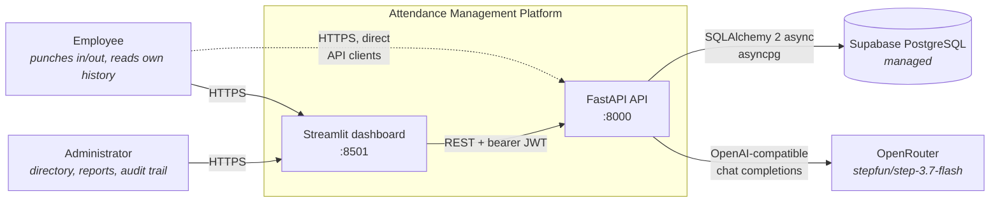
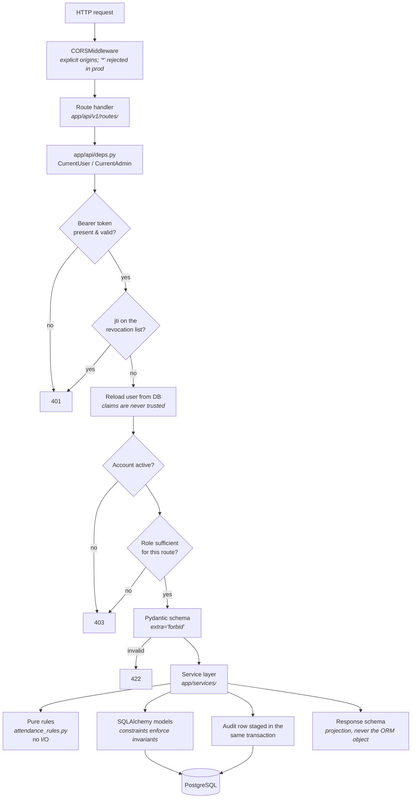
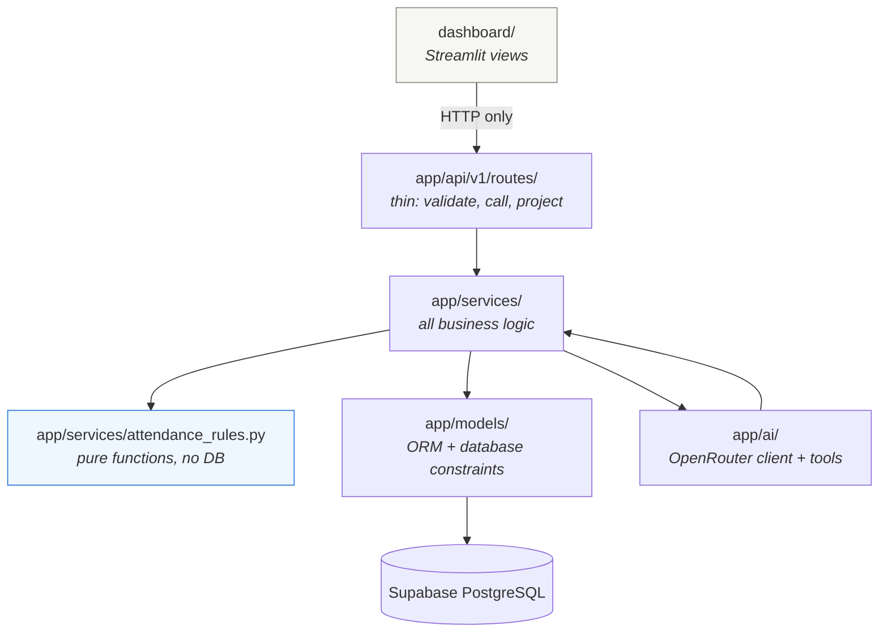

# Architecture

## System context

Who and what the platform talks to.

**The dashboard holds no database credentials.** It reaches data only through
the API, so authentication, authorisation and validation have exactly one
enforcement point. `dashboard/api_client.py` imports nothing from `app`.

## Request path

Every authenticated request takes the same route through the layers.

## Layering rules

Four rules hold everywhere:

1. **Routers stay thin.** A handler validates input, calls a service and
   projects the result. No arithmetic, no queries.
2. **The rules engine is pure.** `attendance_rules.py` has no database
   dependency, so timezone, grace-period and overnight-boundary behaviour is
   unit-tested without Postgres.
3. **Analytics never pass through the model.** Every number in a report or a
   chatbot answer is computed in `app/services/reports.py`; the LLM only
   phrases what was computed.
4. **Invariants live in the database too.** Unique, check and exclusion
   constraints are what actually make concurrent requests safe — the
   application-level checks are for clear error messages, not for correctness.

## Where state lives

| State | Where | Note |
| --- | --- | --- |
| Users, attendance, shifts, leave, audit | Supabase PostgreSQL | the only durable store |
| Access tokens | client-side; `jti` of revoked ones in `revoked_tokens` | JWTs are stateless by design, revocation is not |
| Dashboard session (token, current user, page) | Streamlit per-session state | lost on restart; not shared between replicas |
| Chat conversation history | the client, replayed on each request | no stored-conversation model exists |
| Schema version | `alembic_version` table | migrations only; nothing calls `create_all()` |
