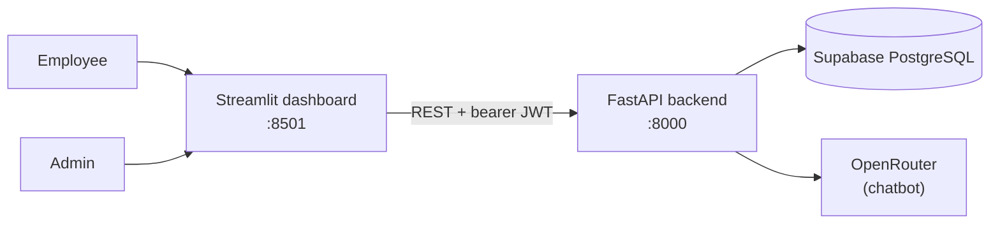

# Architecture

- The dashboard never touches the database directly — every request goes
  through the API, which keeps one place responsible for auth and validation.
- All report and chatbot figures are computed by the API in Python/SQL.
  OpenRouter only phrases the chatbot's answers; it never calculates numbers.
