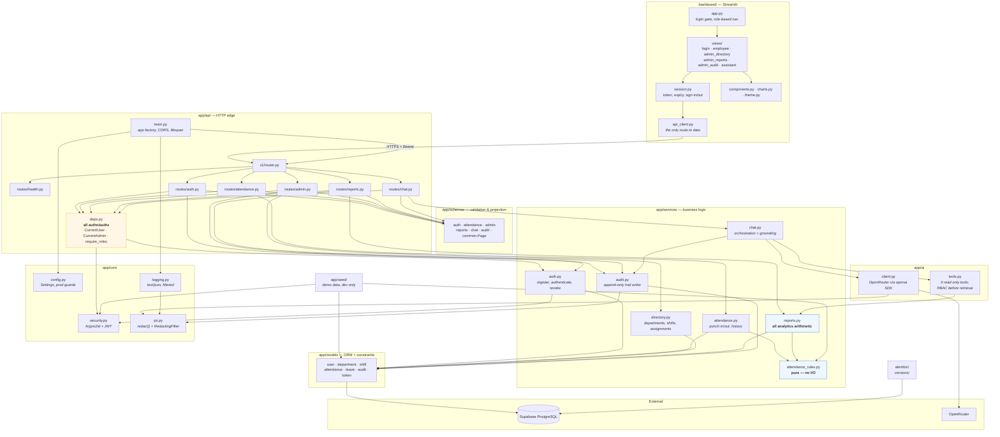
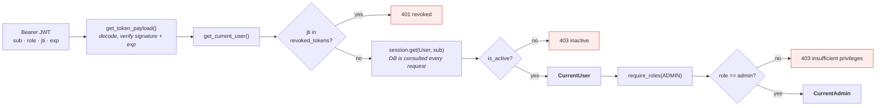
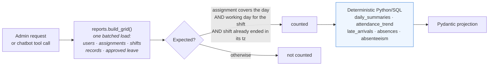
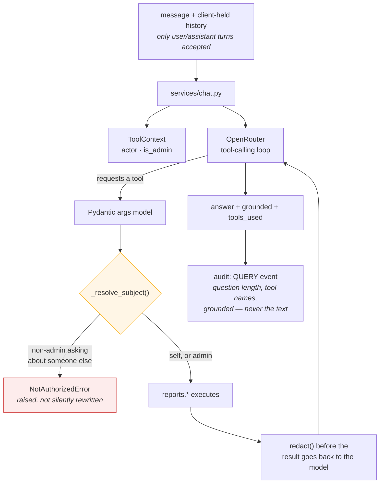
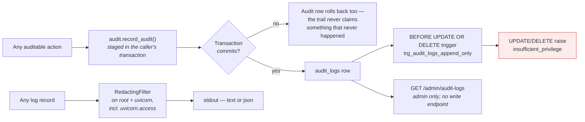

# Components

Modules that exist in the repository today, and what calls what.

## Authentication and RBAC

`UserRole` has exactly two members, `employee` and `admin`. Registration can
never grant admin, enforced twice: `UserRegister` has no `role` field and sets
`extra="forbid"`, and `register_user()` hard-codes `UserRole.EMPLOYEE` without
reading role input at all — so the rule survives the schema being loosened
later.

## Analytics

The grid is built once per request to avoid N+1 queries. Ranges are capped at
**366 days**. **No number is produced by a model.** An absence is derived, not
stored: an expected working day with no attendance record and no approved
leave.

## Chatbot

Authorisation runs **before** retrieval, not after. The model never sees SQL,
never sees rows the caller may not read, and `grounded: false` tells the client
no tool backed the answer.

## Audit logging and PII

`audit_logs` has no `updated_at` because an update column would imply
mutability. Passwords, JWTs, API keys and raw chatbot prompts are never
written. The access log is filtered too — a request line such as
`GET /api/v1/admin/departments?search=jane.doe@acme.com` would otherwise be the
one log everyone tails and the one that is not scrubbed.

## External integrations

| Integration | Module | Configuration | Failure behaviour |
| --- | --- | --- | --- |
| Supabase PostgreSQL | `app/db/session.py` | `DATABASE_URL`, `DB_POOL_*`, `DB_USE_PGBOUNCER` | `/health/ready` fails; requests error |
| OpenRouter | `app/ai/client.py` | `OPENROUTER_API_KEY`, `_BASE_URL`, `_MODEL`, `_TIMEOUT_SECONDS`, `_MAX_RETRIES`, `_MAX_TOKENS` | `POST /chat` returns **503**; nothing else is affected |

The rest of the platform has no runtime dependency on the LLM. If OpenRouter is
down or no key is set, attendance, reporting and administration are unaffected.
