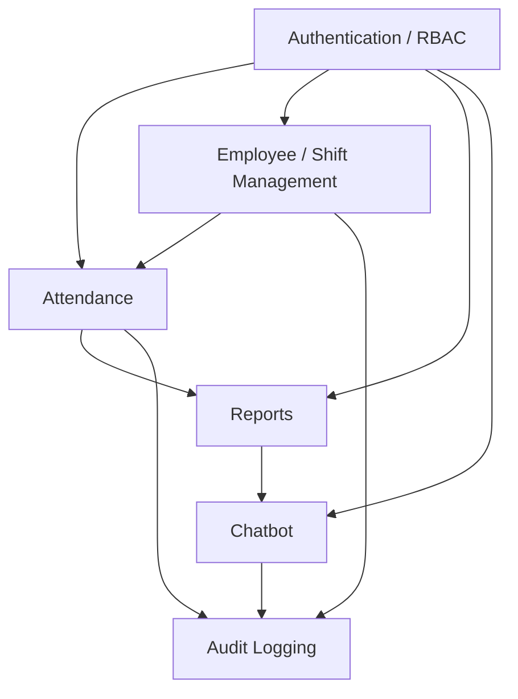

# Components

The major functional modules, and how they relate.

- **Authentication / RBAC** — login, logout, JWT verification; the only two
  roles are `employee` and `admin`.
- **Attendance** — punch in/out and the rules engine that decides late /
  half-day / overtime status.
- **Employee / Shift Management** — departments, shifts and shift
  assignments (admin only).
- **Reports** — daily summaries, trends, late arrivals, absences and
  absenteeism, computed in Python/SQL.
- **Chatbot** — answers attendance questions using the Reports module's data
  through a fixed set of read-only tools.
- **Audit Logging** — every admin action and report/chat query is recorded in
  an append-only log, enforced by a database trigger.
