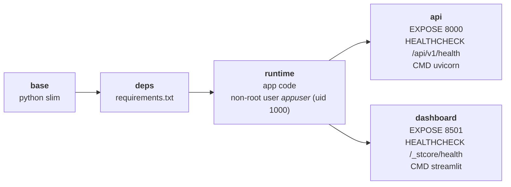
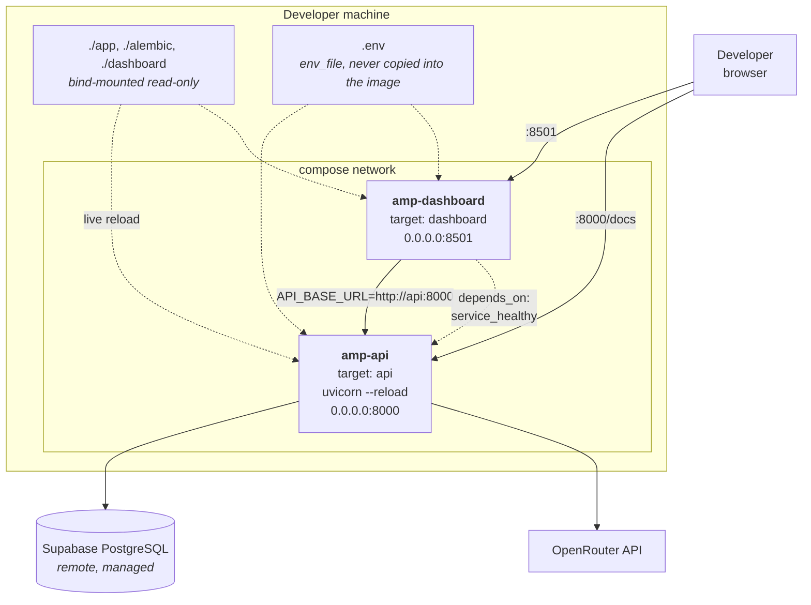
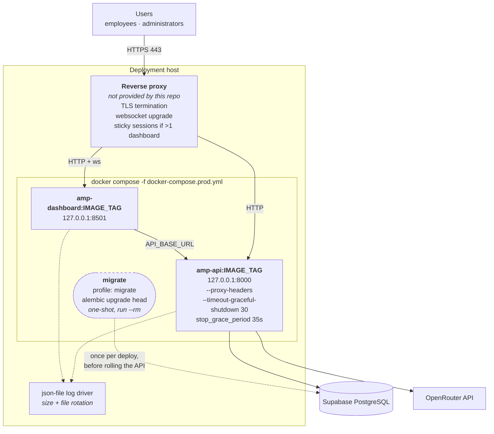
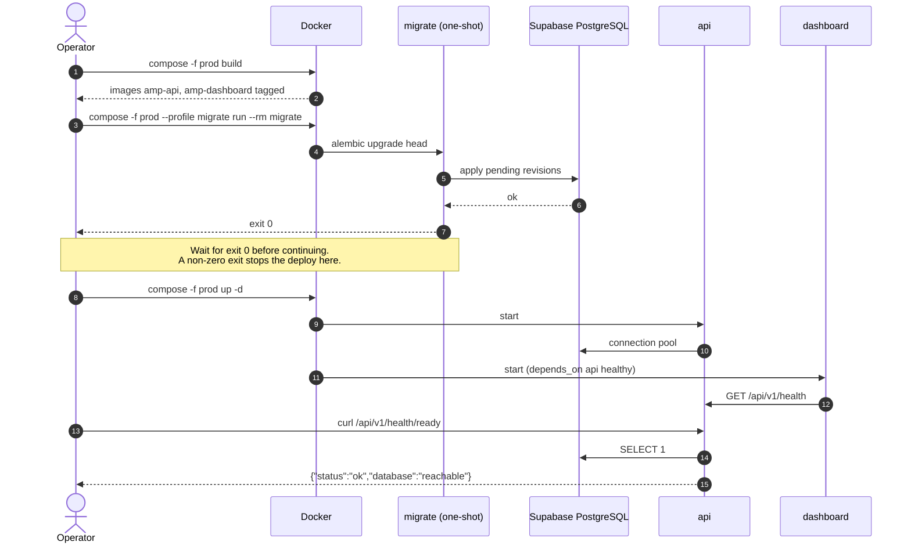

# Deployment

> Nothing here has been deployed. This describes what the committed
> `Dockerfile`, `docker-compose.yml` and `docker-compose.prod.yml` define.

## Images

One multi-stage `Dockerfile` produces two final targets off a shared runtime
layer.

`api` and `dashboard` are separate stages rather than one image run two ways
because `HEALTHCHECK` is baked into the image: sharing a stage would give the
dashboard the API's probe, which it can never pass.

## Development stack — `docker-compose.yml`

Bind mounts and `--reload` are exactly what make this unsuitable for a deploy.
Migrations are never run from here.

## Production stack — `docker-compose.prod.yml`

`docker-compose.prod.yml` is **standalone, not an override**: Compose merges
volume lists by target rather than replacing them, so layering it over the dev
file would keep the bind mounts and `--reload`.

### Why the pieces sit where they do

| Decision | Reason |
| --- | --- |
| Both services bind `127.0.0.1` | uvicorn and Streamlit are never exposed directly; a proxy terminates TLS |
| `migrate` is a profile-gated one-shot | `up` must never migrate: with more than one API replica, every replica would race `alembic upgrade head` against the same database |
| `stop_grace_period: 35s` > `--timeout-graceful-shutdown 30` | the container is not killed while uvicorn is still draining |
| `FORWARDED_ALLOW_IPS` set to the proxy | until it is, uvicorn trusts only `127.0.0.1`, so a forged `X-Forwarded-For` cannot put a false client IP in the audit trail |
| json-file rotation | an unbounded container log fills the host disk |
| `.env` via `env_file`, never `COPY` | secrets stay out of image layers; `.dockerignore` excludes `.env`, `.git`, `.streamlit`, `*.log` |

### Deployment sequence

## Scaling notes

- **The API is stateless** apart from its connection pool, so replicas scale
  horizontally. Mind Supabase's connection ceiling: use the transaction pooler
  (port 6543) with `DB_USE_PGBOUNCER=true`, which disables asyncpg's
  prepared-statement cache.
- **The dashboard is not stateless.** It keeps the auth token in Streamlit's
  per-session state, so more than one replica needs **sticky sessions** — a
  user moved between replicas is signed out.
- **Alembic should use the direct connection (port 5432)**, not the pooler.
