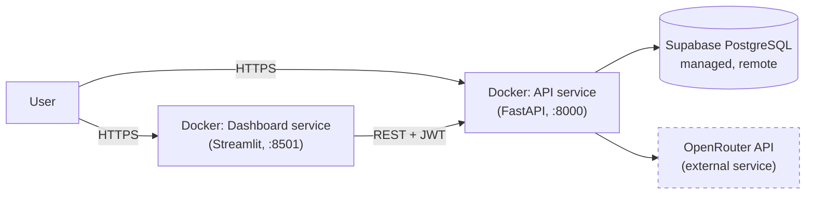

# Deployment

> This describes the committed `Dockerfile` and `docker-compose*.yml` files.
> Nothing here has actually been deployed to a live server.

**Configured today:** the API and dashboard Docker images/services, and the
connection to Supabase PostgreSQL and OpenRouter.

**Not configured / not yet deployed:** a reverse proxy, TLS certificates, and
any real server or cloud hosting. `docker-compose.prod.yml` describes a
production-style stack but has not been run against a live host.

Migrations run as a one-off step (`--profile migrate run --rm migrate`)
before starting the services, so the API never races itself applying schema
changes.
