# Entity-relationship diagram

Derived from the SQLAlchemy models in `app/models/`. Eight tables, all with
UUID primary keys. All carry `created_at` / `updated_at` except `audit_logs`
and `revoked_tokens`, which are never updated.

```mermaid
erDiagram
    USERS ||--o{ ATTENDANCE_RECORDS : "records (CASCADE)"
    USERS ||--o{ EMPLOYEE_SHIFT_ASSIGNMENTS : "is assigned (CASCADE)"
    USERS ||--o{ LEAVE_REQUESTS : "requests (CASCADE)"
    USERS ||--o{ REVOKED_TOKENS : "revokes (CASCADE)"
    USERS ||--o{ AUDIT_LOGS : "acts (SET NULL)"
    USERS ||--o{ LEAVE_REQUESTS : "reviews (SET NULL)"
    USERS ||--o{ ATTENDANCE_RECORDS : "approves (SET NULL)"
    USERS ||--o{ USERS : "manages (SET NULL)"

    DEPARTMENTS ||--o{ USERS : "employs (SET NULL)"
    USERS ||--o| DEPARTMENTS : "heads (SET NULL, use_alter)"

    SHIFTS ||--o{ EMPLOYEE_SHIFT_ASSIGNMENTS : "rosters (RESTRICT)"
    SHIFTS ||--o{ ATTENDANCE_RECORDS : "scores (SET NULL)"

    USERS {
        uuid id PK
        string employee_code UK "32"
        string email UK "255, CHECK email = lower(email)"
        string hashed_password "255, Argon2id"
        string full_name "160"
        string phone "32, nullable"
        string job_title "120, nullable"
        enum role "user_role: employee | admin"
        enum employment_status "active | suspended | terminated"
        bool is_active
        uuid department_id FK "nullable"
        uuid manager_id FK "nullable, CHECK manager_id <> id"
        date date_of_joining "nullable"
        string timezone "64, default UTC"
        timestamptz last_login_at "nullable"
    }

    DEPARTMENTS {
        uuid id PK
        string name UK "120"
        string code UK "20"
        text description "nullable"
        bool is_active "deactivated, never deleted"
        uuid head_id FK "nullable, -> users"
    }

    SHIFTS {
        uuid id PK
        string name UK "120"
        string code UK "20"
        text description "nullable"
        string timezone "64, authoritative for scoring"
        time start_time "naive wall clock"
        time end_time "naive wall clock"
        bool is_overnight "stored, never inferred"
        int break_minutes "CHECK >= 0"
        int grace_period_minutes "CHECK >= 0"
        int half_day_threshold_minutes "CHECK > 0"
        smallint_array working_days "ISO 1=Mon .. 7=Sun"
        bool is_active
    }

    EMPLOYEE_SHIFT_ASSIGNMENTS {
        uuid id PK
        uuid user_id FK
        uuid shift_id FK "ON DELETE RESTRICT"
        date effective_from "UK with user_id"
        date effective_to "nullable = open-ended"
        bool is_primary
    }

    ATTENDANCE_RECORDS {
        uuid id PK
        uuid user_id FK "UK with work_date"
        date work_date "UK with user_id"
        uuid shift_id FK "nullable, denormalised"
        timestamptz check_in_at "nullable, UTC"
        timestamptz check_out_at "nullable, CHECK >= check_in_at"
        enum status "present|absent|late|half_day|on_leave|holiday|weekend"
        enum source "web|mobile|biometric|import|manual"
        int worked_minutes "nullable, CHECK >= 0"
        int late_minutes "default 0"
        int early_leave_minutes "default 0"
        int overtime_minutes "default 0"
        inet check_in_ip "nullable"
        inet check_out_ip "nullable"
        numeric check_in_latitude "9,6 nullable"
        numeric check_in_longitude "9,6 nullable"
        bool is_manual_entry
        uuid approved_by_id FK "nullable -> users"
        text notes "nullable"
        numeric anomaly_score "4,3 CHECK between 0 and 1"
        text anomaly_reason "nullable"
    }

    LEAVE_REQUESTS {
        uuid id PK
        uuid user_id FK
        enum leave_type "annual|sick|casual|unpaid|maternity|paternity|bereavement"
        date start_date
        date end_date "CHECK >= start_date"
        numeric total_days "5,1 CHECK > 0 — half days"
        text reason "nullable"
        string attachment_url "512 nullable"
        enum status "pending|approved|rejected|cancelled"
        uuid reviewed_by_id FK "nullable -> users"
        timestamptz reviewed_at "nullable"
        text review_comment "nullable"
        timestamptz cancelled_at "nullable"
    }

    AUDIT_LOGS {
        uuid id PK
        uuid actor_id FK "nullable, SET NULL — see note"
        enum action "create|update|delete|login|logout|approve|reject|export|read|query"
        string entity_type "64"
        uuid entity_id "nullable"
        jsonb changes "nullable, before/after"
        text summary "nullable"
        inet ip_address "nullable"
        string user_agent "512 nullable"
        timestamptz created_at "no updated_at: append-only"
    }

    REVOKED_TOKENS {
        uuid id PK
        uuid jti UK "the JWT's token id"
        uuid user_id FK
        timestamptz expires_at
        timestamptz revoked_at
    }
```

## Constraints that carry the business rules

These are enforced by PostgreSQL, not only by Python. That is what makes
concurrent requests safe; the application-level checks exist to produce a clear
error message, not to guarantee correctness.

| Constraint | Table | What it guarantees |
| --- | --- | --- |
| `uq_attendance_records_user_work_date` | `attendance_records` | one row per employee per day — the real defence against a double punch-in under a race |
| `checkout_after_checkin` | `attendance_records` | `check_out_at >= check_in_at` |
| `non_negative_worked_minutes` | `attendance_records` | `worked_minutes >= 0` |
| `anomaly_score_range` | `attendance_records` | score within `[0, 1]` |
| `ex_employee_shift_assignments_no_overlap` | `employee_shift_assignments` | GiST `EXCLUDE` over `(user_id, daterange(effective_from, effective_to))` — an employee can never hold two overlapping assignments. Written by hand in the migration: Alembic cannot autogenerate or diff exclusion constraints. Requires the `btree_gist` extension. |
| `uq_employee_shift_assignments_one_open_primary` | `employee_shift_assignments` | partial unique index — at most one open-ended primary shift per employee |
| `uq_..._user_effective_from` | `employee_shift_assignments` | no two assignments start on the same day for one employee |
| `valid_date_range` | `employee_shift_assignments`, `leave_requests` | end not before start |
| `decided_requires_reviewer` | `leave_requests` | an approved or rejected request must name who decided it and when |
| `positive_total_days` | `leave_requests` | `total_days > 0` |
| `email_lowercase` | `users` | `email = lower(email)` — case-insensitive identity without a functional index |
| `manager_not_self` | `users` | nobody manages themselves |
| `trg_audit_logs_append_only` | `audit_logs` | a `BEFORE UPDATE OR DELETE` PL/pgSQL trigger raising `insufficient_privilege` — neither a future endpoint nor a direct `psql` session can rewrite history |

## Deliberate modelling choices

- **Attendance is daily-grained**, not one row per punch. That is what makes
  `(user_id, work_date)` uniquely enforceable; multiple punches fold into
  first-in / last-out.
- **`attendance_records.shift_id` is denormalised** from the assignment table
  on purpose, so reassigning someone's shift later does not retroactively
  change whether they were late last month.
- **Assignment rows are kept, not overwritten**, so historical attendance can
  be judged against the shift that was actually in force at the time.
- **`shifts.timezone` is authoritative** for scoring. A shift is a property of
  the workplace, not of whoever is rostered onto it, so two employees on the
  same shift are judged late at the same instant regardless of where they live.
  `users.timezone` is only a fallback when no shift is assigned.
- **`departments.head_id` and `users.department_id` reference each other**, so
  the former is declared `use_alter=True` with `post_update=True` to break the
  dependency cycle at DDL and flush time.
- **Delete behaviour is explicit on every FK**: `CASCADE` for rows meaningless
  without their user, `SET NULL` for references that must survive a deletion,
  `RESTRICT` on `shifts` so a shift that has been worked cannot vanish.
- **There is no `manager` role.** `users.manager_id` and `departments.head_id`
  record reporting lines; they grant no privileges. Authorisation reads
  `users.role` only.
- **Absence is not a stored status in practice.** `AttendanceStatus.ABSENT`
  exists, but reporting derives an absence as *an expected working day with no
  attendance record and no approved leave*.

## Known modelling conflict

`audit_logs.actor_id` is declared `ON DELETE SET NULL`, so that deleting a user
never erases the trail of what they did. But `trg_audit_logs_append_only`
rejects **any** `UPDATE` on the table — including the one PostgreSQL issues to
apply that `SET NULL`. The result: **a user with audit history cannot be
deleted.** Verified empirically; the delete fails with
`InsufficientPrivilegeError: audit_logs is append-only: UPDATE is not permitted`.

This is not reachable through the API today — there is no delete-user endpoint
— and it is left unresolved on purpose, because the fix is a policy decision
about retention versus erasure rather than a bug. See
[`docs/tradeoffs.md`](../tradeoffs.md#audit-retention-versus-the-right-to-erasure).
