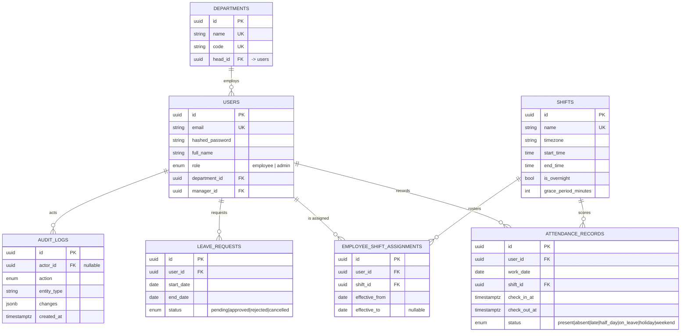

# Entity-relationship diagram

The main tables and their relationships, from `app/models/`.

Notes:

- A user can have at most one active shift assignment at a time — enforced
  by a database constraint, not just application code.
- `attendance_records` has one row per employee per day (not per punch).
- `audit_logs` is append-only: a database trigger blocks `UPDATE`/`DELETE`.
  This is why a user with audit history currently cannot be deleted — see
  [`docs/tradeoffs.md`](../tradeoffs.md) for the open decision.
