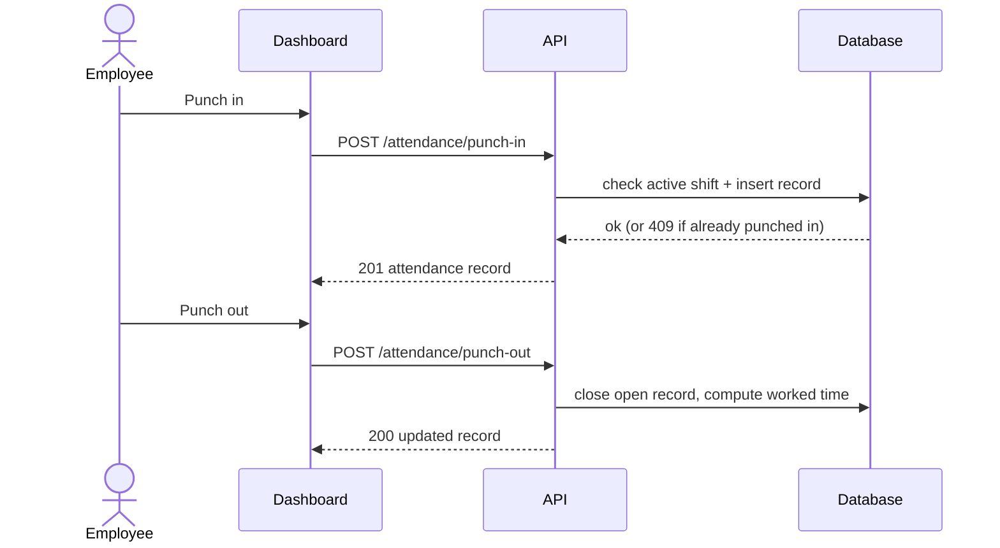
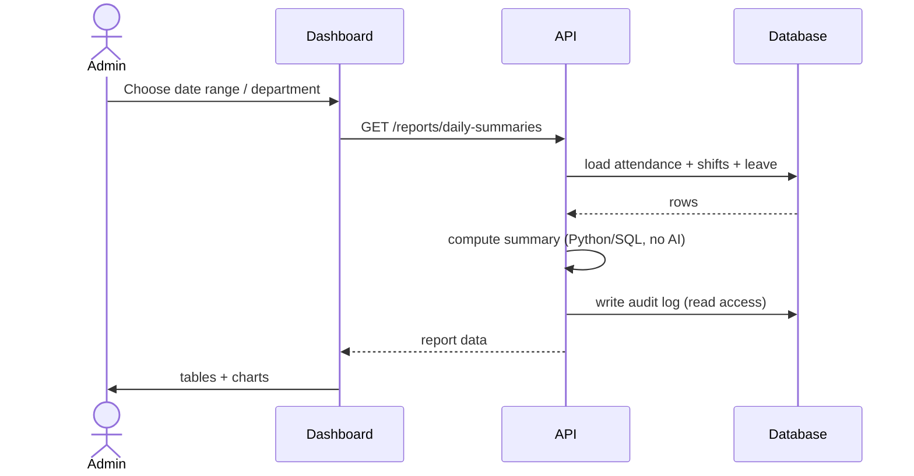
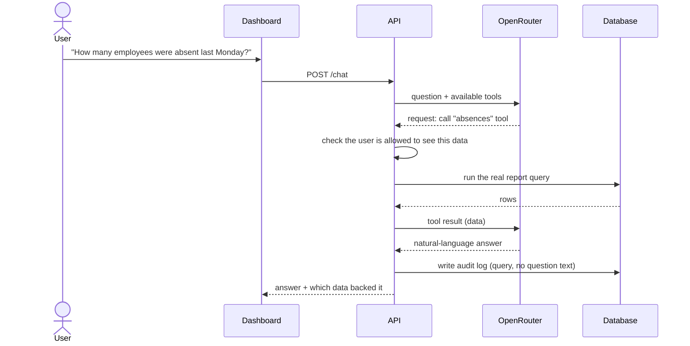

# Sequence diagrams

Three core flows, kept short enough to walk through in a demo.

## 1. Employee punch-in / punch-out

Late, half-day and overtime status are computed by a rules engine using the
employee's shift (timezone, grace period, working hours).

## 2. Admin attendance report

## 3. Chatbot question-answer

The model never runs SQL or computes numbers itself — it only picks a tool
and phrases the result. Access checks happen before any data is fetched.
