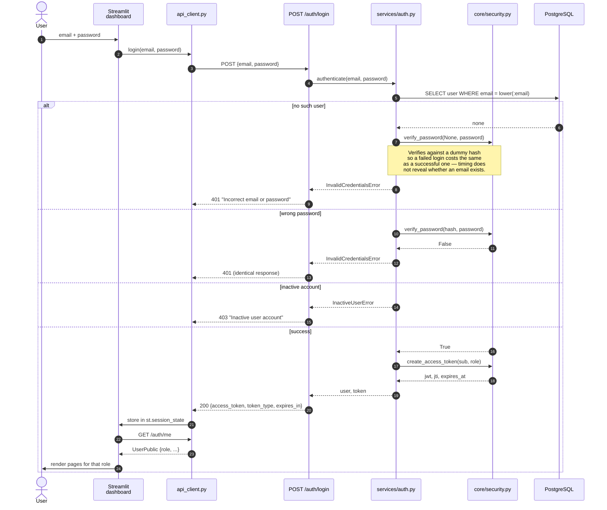
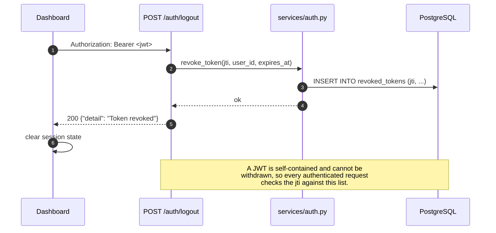
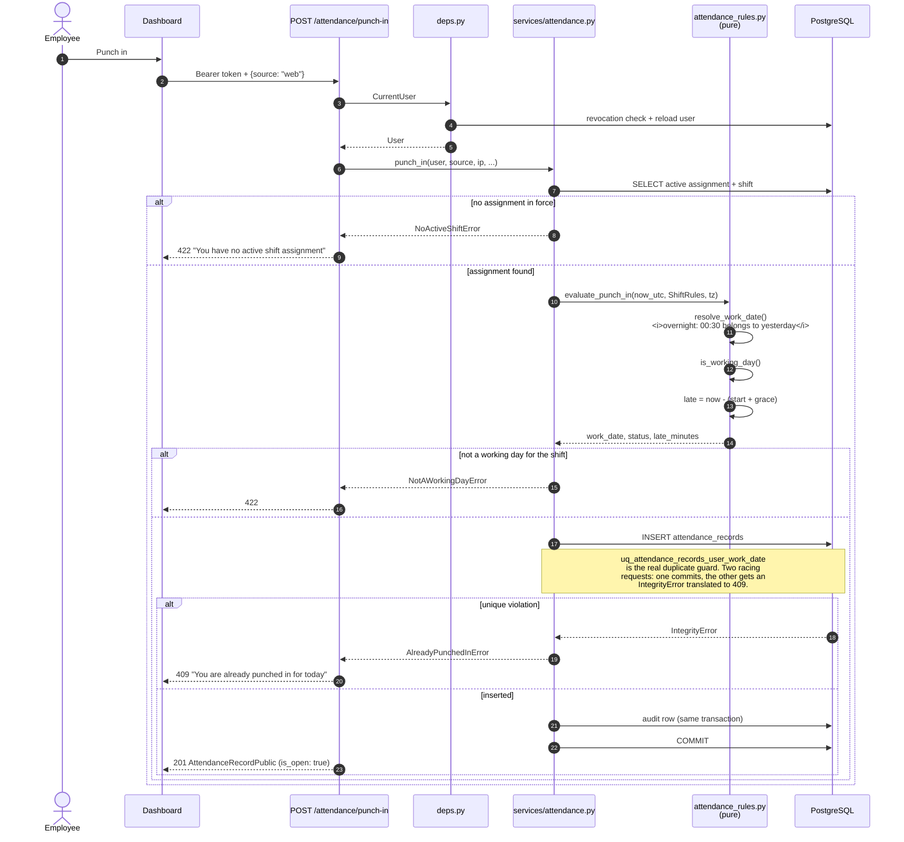
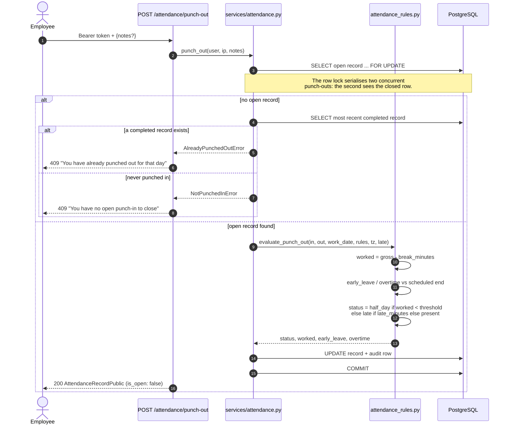
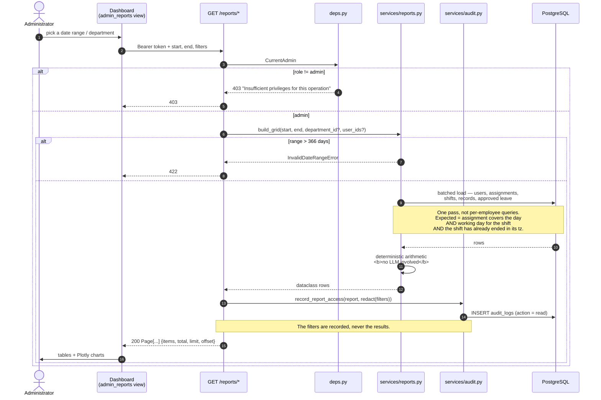
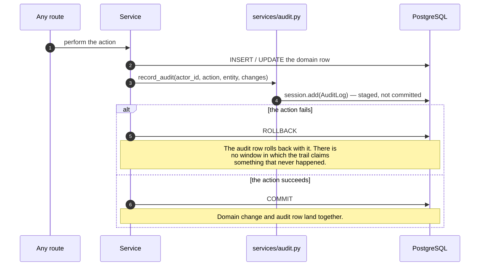
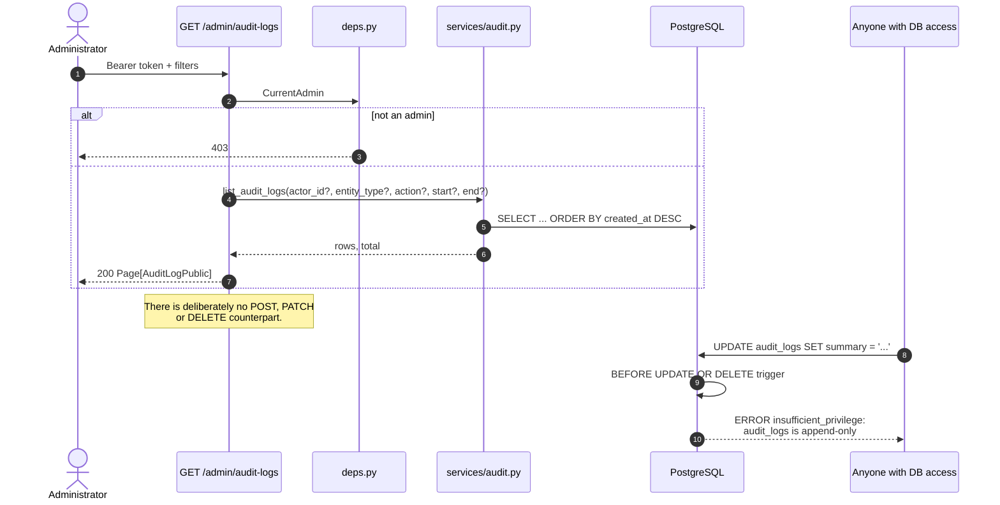

# Sequence diagrams

Each diagram traces a flow that exists in the code today.

---

## 1. Login



The dashboard caches the role from `/auth/me` at sign-in, so **a role changed
in the database takes effect only after signing out and back in.**

### Logout



---

## 2. Punch in / punch out





---

## 3. Admin reporting



---

## 4. Employee and shift administration

```mermaid
sequenceDiagram
    autonumber
    actor AD as Administrator
    participant S as Dashboard<br/>(admin_directory view)
    participant R as /admin/shifts, /admin/assignments
    participant DIR as services/directory.py
    participant DB as PostgreSQL

    AD->>S: create shift "Night Support" 22:00-06:00
    S->>R: POST /admin/shifts {..., is_overnight: true}
    Note over R: ShiftCreate validates: known IANA timezone,<br/>ISO weekdays 1-7 with no duplicates,<br/>and an unambiguous window —<br/>overnight requires end <= start.
    alt window inconsistent with is_overnight
        R-->>S: 422
    else valid
        R->>DIR: create_shift(payload)
        DIR->>DB: INSERT shifts
        alt duplicate name or code
            DB-->>DIR: IntegrityError
            DIR-->>R: DuplicateError
            R-->>S: 409 (operator wording; no table or<br/>constraint name is echoed)
        else
            DIR->>DB: audit row + COMMIT
            R-->>S: 201 ShiftPublic
        end
    end

    AD->>S: assign an employee to the shift
    S->>R: POST /admin/assignments {user_id, shift_id, effective_from}
    R->>DIR: create_assignment(...)
    DIR->>DB: INSERT employee_shift_assignments
    alt overlaps an existing assignment
        DB-->>DIR: ExclusionViolation<br/>(GiST EXCLUDE on user_id + daterange)
        DIR-->>R: AssignmentConflictError
        R-->>S: 409
    else
        DIR->>DB: audit row + COMMIT
        R-->>S: 201 AssignmentPublic
    end

    AD->>S: retire the shift
    S->>R: POST /admin/shifts/{id}/deactivate
    R->>DIR: deactivate_shift(id)
    DIR->>DB: UPDATE shifts SET is_active = false
    Note over DIR,DB: Deactivated, never deleted. The FK from<br/>assignments is ON DELETE RESTRICT, so a<br/>shift that has been worked cannot vanish<br/>and attendance history stays interpretable.
    R-->>S: 200 ShiftPublic
```

Closing an assignment uses `POST /admin/assignments/{id}/end`. Repointing an
assignment at a different shift is deliberately not offered — closing one and
opening another leaves the history showing what was actually in force.

---

## 5. Chatbot query

```mermaid
sequenceDiagram
    autonumber
    actor U as User
    participant S as Dashboard<br/>(assistant view)
    participant R as POST /chat
    participant CH as services/chat.py
    participant OR as OpenRouter
    participant T as ai/tools.py
    participant RP as services/reports.py
    participant AU as services/audit.py
    participant DB as PostgreSQL

    U->>S: "How many employees were absent last Monday?"
    S->>R: Bearer token + {message, history[<=10]}
    Note over R: Only user/assistant turns are accepted.<br/>A system turn would let a client rewrite<br/>the rules; a tool turn would let one<br/>fabricate a result never computed.

    R->>CH: answer(user, message, history)
    CH->>OR: chat.completions with tool schemas

    alt provider unreachable / no API key
        OR-->>CH: error or timeout
        CH-->>R: AssistantUnavailableError
        R->>AU: record_chat_query(outcome="unavailable")
        R-->>S: 503 (nothing about the provider<br/>or the key is echoed back)
    else tool call requested
        OR-->>CH: tool_call absences{start_date, end_date}
        CH->>T: execute(ctx, name, raw_args)
        T->>T: validate args (Pydantic)
        T->>T: _resolve_subject(ctx, employee_code)
        alt non-admin asking about someone else
            T-->>CH: NotAuthorizedError
            Note over T: Raised, not silently rewritten to<br/>"your own data" — the refusal is<br/>visible rather than disguised.
        else self, or admin
            T->>RP: build_grid + reports.absences(grid)
            RP->>DB: batched read
            DB-->>RP: rows
            RP-->>T: computed rows
            T->>T: redact() before returning to the model
            T-->>CH: {total, items, definition}
        end
        CH->>OR: tool result
        OR-->>CH: natural-language answer
        CH-->>R: answer, grounded=true, tools_used
        R->>AU: record_chat_query(question_chars, tools, grounded)
        AU->>DB: INSERT audit_logs (action = query)
        Note over R,AU: The question text is deliberately absent.<br/>What is kept — which tools ran and whether<br/>the answer was grounded — is what makes<br/>an answer reconstructible later.
        R-->>S: 200 {answer, grounded, tools_used}
        S->>U: answer + which lookups backed it
    end
```

The model never sees SQL and never receives rows the caller may not read.
`grounded: false` means no tool backed the answer — a refusal, a greeting, or a
model that ignored its instructions — and the dashboard presents those
differently from a figure that came out of the database.

---

## 6. Audit logging

Audit rows are not written by a separate call after the fact. They are staged
in the **same transaction** as the change they describe.





The trigger is why the trail is append-only *in fact* and not merely by
convention: neither a future endpoint nor a direct `psql` session can rewrite
history. The cost of that guarantee is documented in
[`er-diagram.md`](er-diagram.md#known-modelling-conflict).
